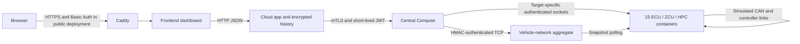

# Automotive Cybersecurity Scanner Architecture

This document is the single source of truth for the project architecture and folder responsibilities. Any future additions should be recorded here.

## System Overview

The project implements an automotive cybersecurity scanner and behavior-analysis platform with four application layers:

1. Frontend dashboard container
2. Cloud application container
3. Vehicle central compute container
4. Vehicle-network aggregate service and 15 separate simulated node containers

Compose runs 19 containers by default: frontend, cloud app, central compute,
vehicle-network aggregate, and 15 vehicle nodes. The optional `public-dashboard`
profile adds Caddy as a twentieth container for HTTPS and authentication.
The shared configuration folder is not a runtime container.



Local development can access the frontend directly on loopback port `3000`
without Caddy. Protocol-shaped traffic is simulator-only, never physical CAN.

## Container Responsibilities

### 1. Frontend Dashboard Container
Purpose:
- User dashboard
- Live monitoring
- Control interface for security scans
- Visualization of vehicle network states and anomalies

Responsibilities:
- Show live attack and defense status
- Display network telemetry and behavioral findings
- Allow users to trigger scans and review results

### 2. Cloud Application Container
Purpose:
- Central orchestration and intelligence
- Trigger scanner runs in the vehicle central compute layer
- Aggregate results across the system
- Support AI-assisted analysis and reporting

Responsibilities:
- Receive instructions from user or dashboard
- Start scanner jobs in central compute
- Retrieve telemetry, attack outcomes, and security events
- Correlate data across sessions and incidents
- Generate deterministic reports using a bundled reference corpus, with optional Gemini text generation when configured

### 3. Vehicle Central Compute Container
Purpose:
- Hosts application-layer cybersecurity services and a standalone HPC companion model
- Reads the vehicle-network socket feed
- Runs scan orchestration, behavior analysis, and the OTA client

Responsibilities:
- Keep a standalone HPC companion model in `vehicle-central-compute/scanner/hpc_vehicle_model.py`; it is not a live simulator node
- Keep scanner, behavior-analysis, and OTA-client responsibilities in separate packages
- Own attack-test plans such as:
  - flooding
  - replay attack
  - repudiation
  - DoS
  - tampering
  - other vehicle-network security tests
- Collect network diagnostics, ECU behavior, DTC catalogs, and security events from the socket feed
- Analyze traffic using Isolation Forest against the pre-scan behavior baseline
- Detect modeled anomalies and classify risk; simulator findings do not establish a real compromise
- Return aggregate findings to the cloud application; keep raw node diagnostics, signal values, and message/event records out of cloud scan history

### 4. Vehicle Network Container
Purpose:
- Simulated target environment for the vehicle system
- Represents real SDV network behavior under test

Responsibilities:
- Define individual ECUs, zone controllers, domain HPCs, and backbone links in per-node modules under `vehicle-network_Simulator/`
- Own all live simulated vehicle nodes, including `vehicle-network_Simulator/ecus/hpc_vehicle_node.py`
- Route safety-critical ECUs directly to their responsible HPC
- Route non-safety body and telematics ECUs through their local ZCU
- Forward validated zone and direct-CAN data to the vehicle HPC over TCP
- Publish topology, messages, diagnostics, UDS metadata, and DTC catalogs to the scanner container over an authenticated TCP socket
- Keep attack planning and analysis in the vehicle-central-compute container

### In-Vehicle Data Hierarchy

- Safety-critical powertrain and battery ECUs connect directly to `hpc-vehicle`.
- Safety-critical radar and camera ECUs connect directly to `hpc-adas`.
- Non-safety body and telematics ECUs connect to their local ZCU.
- Every ZCU forwards its zone data to `hpc-vehicle` for whole-vehicle aggregation, and to relevant ADAS/cockpit domain HPCs.
- The domain HPCs and vehicle HPC share the modeled Automotive Ethernet backbone.
- `hpc-vehicle` behavior/state is hosted by the live simulator node `hpc_vehicle_node.py`. The separate central-compute `hpc_vehicle_model.py` is a companion model, not another live node; central compute is not itself modeled as an ECU.

### Shared Configuration and Deployment Folder
Purpose:
- Standardize environment setup
- Simplify deployment to the cloud
- Support GCP VM deployment and plug-in integration

Responsibilities:
- Manage dependencies
- Store environment variables and VM configuration
- Configure model parameters and deployment settings
- Enable live cloud visualization of attacks, telemetry, and outcomes

## Scan Lifecycle and Data Minimization

1. The dashboard selects an attack scenario, severity, simulated duration (1-60 seconds), and vehicle service state.
2. Central compute rejects scans unless the simulator reports `in_service`.
3. Central compute collects a pre-test behavior snapshot and, when baseline checks are enabled, full-network SOVD-style DTC diagnostics.
4. Central compute supplies bounded test plans to the authenticated simulator. The simulator sends protocol-shaped frames or diagnostic/firmware probes to node handlers; optional baseline protocol probes run first. General untrusted frame injection remains disabled.
5. Central compute repeats diagnostics and behavior analysis, then returns aggregate counts, category totals, risk scores, and before/after deltas.
6. The cloud persists only allowlisted analytics; raw network snapshots, identifiers, signals, and per-node records are filtered from new and historical scan responses.

The service state defaults to `out_of_service`. Central-compute scan/API, scenario, and socket-client code is organized under `scanner/`; scoring is under `behavior_analysis/`; OTA relay logic is under `ota_client/`. This design minimizes cloud data but does not, by itself, establish legal compliance; deployment owners remain responsible for DPDP obligations, access controls, and retention policy.

Flooding supports all simulated ECU, ZCU, and HPC nodes in every mode.
`service_center_safe` retains its medium-severity ceiling and blocks the
separate `dos` scenario. All tests retain the 1-60 second bound, in-service
gate, and Stop control. New observed security events are identified against
the pre-test snapshot by event identity, avoiding count-delta errors when the
500-record snapshot window fills. Only aggregate counts/categories leave
Central Compute; counts cannot include new events already evicted from that window.

## Folder Mapping

```text
automotive-cybersecurity-scanner/
├── frontend/                  # Container 1: dashboard and UI layer
├── cloud-app/                 # Container 2: cloud orchestration, API, AI, incident correlation
├── vehicle-central-compute/    # Scan orchestration, behavior analysis, OTA relay
├── vehicle-network_Simulator/  # Aggregate service and 15 live simulated node services
├── config/                    # Shared config and deployment support (not a runtime container)
├── docker-compose.yml
├── README.md
├── ARCHITECTURE.md
└── ...
```

## Core Design Flow

1. The frontend/dashboard provides user visibility and control.
2. The cloud app triggers a scanning workflow.
3. Vehicle ECUs publish simulated messages and diagnostic metadata through their zone/domain links.
4. Safety-critical ECUs feed their HPC directly; other ECUs reach HPCs through their local ZCU.
5. The simulator forwards authenticated zone, direct-CAN, and HPC-peer messages to the authoritative `hpc-vehicle` runtime over TCP.
6. Central compute performs scan planning, behavior analysis, and OTA-client workflows; ECU implementations remain in the simulator.
7. SOVD/UDS routes from the vehicle HPC return through simulator CAN, DoIP, and SOME/IP sockets.
8. Results are sent back to the cloud app for dashboard display and incident history.

## Implementation Status

The simulator has 15 nodes: three live HPCs, four ZCUs, and eight functional
ECUs. Each node has topology, message, UDS-service, security-feature, and DTC
metadata and owns its runtime state in its own container. The live
`hpc-vehicle` aggregates all four ZCUs and the eight ECUs through zone, direct,
and HPC-peer routes; five safety-critical ECUs have direct HPC links.

Each ECU, ZCU, and HPC node container exposes its authenticated node TCP socket on port `6001`; the central `vehicle-network` service also exposes a separate aggregate socket on port `6001` for network-wide snapshots and read/diagnostic requests. ZCU and HPC node containers expose their controller CAN/CAN-FD socket on port `6003`. Controllers use a dedicated authenticated ZCU-HPC TCP link on port `6004`, and HPCs expose a separate Cloud-HPC service socket on port `6005`. Safety-critical ECUs attach directly to their HPC CAN socket; non-safety local ECUs attach to their owning ZCU CAN socket. These are simulated TCP sockets carrying authenticated protocol-shaped frame envelopes, not physical CAN interfaces. Set `VEHICLE_SOCKET_SECRET` to a random value at least 32 characters long in the environment; do not commit it. HMAC authenticates and protects integrity but does not encrypt the payload. Use a TLS/mTLS layer before deployment on an untrusted network.

OTA requests enter through Cloud App `/api/ota/flash`, Central Compute `/ota/flash`, and the authenticated vehicle-network socket. Each target node validates its own package and topology route, runs its UDS programming sequence, or stages and switches its inactive HPC A/B partition. The network service supplies only the topology registry and authenticated CAN/DoIP socket transport for routed diagnostic requests; it does not execute the OTA workflow or apply node software profiles. A signed manifest can activate an allowlisted, target-node-only `software_profile` to simulate changes to SecurityAccess, authentication, replay/freshness, rate/timing, range/message-ID validation, diagnostic authorization, zonal segmentation, firmware-signature/downgrade policy, IDS logging, or signal values. Protections default to enabled; firmware-signature and anti-downgrade enforcement use the node's currently installed profile. Profile state and IDS counters feed the per-node behavior features so OTA changes remain visible even before a message-level violation occurs. The firmware image is hash-checked as data and never executed; none of these operations flashes physical hardware.

Socket data is simulated runtime activity, not measurements from a real vehicle.
UDS state and DTCs belong to the corresponding simulator nodes, including the
vehicle HPC. Diagnostic sessions and firmware transfer are simulator-only; no
hardware flash is performed. Authorized bounded tests execute against simulator
handlers using plans from Central Compute; arbitrary `inject_frames` requests
remain disabled. Isolation Forest scoring, persistent scan history, deterministic
reference-grounded reports, and optional Gemini generation are implemented.
Production incident correlation and real CAN/CAN-FD/Ethernet interfaces are not.

Scan history is persisted in SQLite and retained in a Docker named volume; the cloud API and dashboard can retrieve records after a service restart. The Flask development debugger is disabled by default.

## Project Rule

This architecture is the baseline for the project. Any new implementation should be added in the correct folder and any relevant changes should be updated here instead of re-deriving the system repeatedly.
