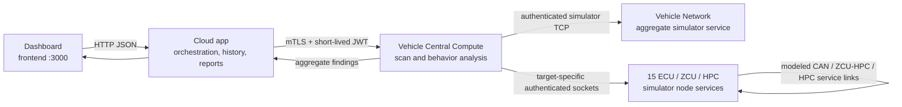

# AegisDrive Automotive Cybersecurity Scanner

AegisDrive is an automotive cybersecurity prototype for exploring security
assessment workflows against a simulated software-defined vehicle (SDV). It
combines a dashboard, cloud-style orchestration API, central scan service, and
a multi-node vehicle-network simulator.

> **Live demo:** [aegisdrive-automotive.duckdns.org](https://aegisdrive-automotive.duckdns.org)
> — dashboard access requires credentials shared privately by the project team.

All vehicle, protocol, diagnostic, attack, and firmware-update activity in
this repository is simulated. It does not connect to or test a physical
vehicle.

> **Prototype notice:** This is research/demo software, not a production
> vehicle security product, certified test tool, OEM security case, or
> standards-conformance implementation. Do not use it to test a real vehicle
> or expose its internal APIs to the public internet.

## At a glance

| Topic | What is implemented |
| --- | --- |
| Simulated fleet | 15 modeled nodes: 8 ECUs, 4 zone control units (ZCUs), and 3 high-performance computers (HPCs) |
| Scan scenarios | 10 bounded simulator scenarios, configurable severity and 1–60 second test duration |
| Protocol model | CAN/CAN-FD-shaped frames, SOME/IP, DoIP, UDS, SOVD-style diagnostics, and authenticated simulator TCP sockets |
| Analysis | Before/after network and diagnostic observations, baseline-relative behavior features, Isolation Forest scoring, and explainable aggregate findings |
| OTA exploration | Synthetic signed-manifest packages, per-node simulated update workflows, software-profile weaknesses, and OTA assurance findings |
| Dashboard | Live network and socket activity, attack/scan progress, node profiles, current findings, analytics, and report downloads; scan history is available through APIs |
| Reports and CVEs | Markdown/XLSX scan reports; local CVE catalog, optional NVD synchronization, and SBOM component matching |
| Local runtime | Docker Compose-compatible multi-container stack; Podman through the Docker-compatible Compose command works in WSL |

For measured simulator coverage and the small initial performance sample, see
[Prototype Performance and Benchmarking](PROTOTYPE_PERFORMANCE_AND_BENCHMARKING.md).
For the detailed component design, see [Architecture](ARCHITECTURE.md).

## What you can explore

### 1. Dashboard and scan lifecycle

The dashboard is served at `http://localhost:3000` after startup. **Setup &
controls** provides node selection, OTA and diagnostic tools, profiles, and scan
controls. **Live packet console** shows socket traffic and phase-filtered
activity. **Dashboard & reports** shows the latest assessment's outcomes,
before/after charts, findings, and Markdown/XLSX exports. Persisted history is
available through the history/evidence APIs, not a dashboard history tab.

An authorized scan follows this high-level sequence:

1. Select an attack scenario, severity, target scope, and duration.
2. Set the simulated vehicle service state to `in_service`. The simulator
   defaults to `out_of_service`; scans are blocked until explicitly enabled.
3. Central Compute captures a pre-test snapshot and (when enabled) diagnostics.
4. Optional baseline protocol probes and a bounded test execute against simulator handlers.
5. Post-test observations are compared with the baseline and summarized.
6. Findings appear in the dashboard and are saved in history; Markdown and XLSX reports can be
   downloaded from the final report step.

The supported attack scenario identifiers are:

`flooding`, `replay_attack`, `repudiation`, `dos`, `tampering`, `spoofing`,
`unauthorized_diagnostics`, `cross_zone_access`, `invalid_firmware`, and
`ids_auditability_regression`.

Bounded simulator flooding is available for every ECU, ZCU, and HPC in all
assessment modes. Explicit target selection limits the test to those nodes;
without explicit targets, the flooding scenario includes all simulated nodes.
Scan policy depends on mode. `service_center_safe` limits severity to medium
and blocks the separate `dos` scenario; `oem_validation` and `lab_penetration_test` allow the bounded
simulator scenarios subject to their configured policy. The dashboard and API
validate inputs; the Central Compute layer independently checks service state.
The Stop control ends the test window while allowing post-test analysis to
complete.

### 2. Modeled vehicle network and protocols

The Compose topology contains eight functional ECUs, four ZCUs, and three HPCs.
Safety-critical ECUs have direct modeled HPC links; other zone ECUs route
through their ZCU. Each node owns its simulated state and protocol handling.

The simulator exercises protocol-shaped behavior through private TCP sockets:

| Port | Modeled use |
| --- | --- |
| `6001` | Authenticated node socket; a separate aggregate vehicle-network socket serves network-wide snapshots |
| `6003` | ZCU/HPC CAN and CAN-FD frame socket |
| `6004` | ZCU–HPC controller link |
| `6005` | HPC service socket |

These are application-level simulator sockets, not physical CAN interfaces or
raw vehicle-network access. HMAC authenticates simulator socket messages but
does not encrypt them; keep these endpoints on the private Compose network.
The scanner's protocol probes cover modeled validation such as invalid message
IDs, ranges, authentication/freshness, timing/rate limits, malformed
SOME/IP/DoIP/UDS requests, and diagnostic access failures.

### 3. OTA packages and weakness profiles

The [`ota packages/`](ota%20packages/) directory contains synthetic JSON
packages for modeled nodes. `BaselineSecure Packages/` contains secure
profiles; `Attack Prone Packages/` contains variants that disable selected
controls. Package names identify the associated weakness family (`W1`–`W10`).
The packages contain generated test bytes and simulator manifests; they are not
deployable firmware.

The 13 modeled profile controls include security access, message
authentication, replay/freshness protection, rate/timing/range/message-ID
validation, diagnostic access, zonal segmentation, firmware-signature and
anti-downgrade checks, and IDS logging. A profile applies to one selected
simulator node. OTA verifies package metadata and models node-specific update
behavior; it does **not** flash hardware or execute firmware.

To check the generated package set without rewriting it, use the project
Python environment:

```powershell
& 'C:\path\to\python.exe' '.\ota packages\generate_packages.py' --check
```

Package details and caveats are documented in
[`ota packages/README.md`](ota%20packages/README.md).

### 4. Behavior analysis, evidence, and cloud features

Central Compute evaluates before/after behavior and diagnostic summaries. The
Isolation Forest model is calibrated from the observed pre-test baseline; its
scores are prototype indicators, not thresholds calibrated on a production
fleet. The cloud layer stores allowlisted aggregate results in encrypted
SQLite-backed history. Raw frames and per-node diagnostic payloads are not
intended to be persisted in cloud scan history.

Cloud threat summaries use a bundled static reference corpus and deterministic
local analysis. Gemini text generation is optional and requires an operator
configured `GEMINI_API_KEY`; without it, local deterministic reports remain
available. The CVE catalog supports operator imports, optional bounded NVD
synchronization, and component/SBOM matching. These features do not constitute
a live vulnerability feed or a formal compliance assessment.

## Architecture



There are four application roles; the 15 vehicle-node containers are separate
simulator actors defined in Compose. The `vehicle-central-compute` service is
an application/scan service, not an additional live ECU. The live simulated
vehicle HPC node is in
[`vehicle-network_Simulator/ecus/hpc_vehicle_node.py`](vehicle-network_Simulator/ecus/hpc_vehicle_node.py);
[`vehicle-central-compute/scanner/hpc_vehicle_model.py`](vehicle-central-compute/scanner/hpc_vehicle_model.py)
is a separate companion model.

## Project structure

```text
automotive-cybersecurity-scanner/
├── README.md                         # Project entry point and local run guide
├── ARCHITECTURE.md                   # Detailed architecture and data-flow notes
├── PROTOTYPE_PERFORMANCE_AND_BENCHMARKING.md
├── docker-compose.yml                # App services and 15 simulated vehicle nodes
├── frontend/
│   ├── app.py                         # Dashboard-serving app and frontend API proxy
│   └── dashboard.html                # Dashboard UI
├── cloud-app/
│   ├── app.py                         # Orchestration, history, reports, CVE APIs
│   ├── threat_explainer.py            # Deterministic/optional Gemini report summaries
│   └── cve_store.py                   # Local CVE catalog and matching
├── vehicle-central-compute/
│   ├── scanner/                       # Scan API, scenarios, orchestration, OTA relay
│   ├── behavior_analysis/             # Features, baselines, anomaly scoring
│   └── ota_client/                    # Simulator OTA client
├── vehicle-network_Simulator/
│   ├── network_service.py              # Aggregate network service and socket routing
│   └── ecus/                           # Individual ECU, ZCU, and HPC node behavior
├── ota packages/
│   ├── BaselineSecure Packages/        # Synthetic secure-profile packages
│   ├── Attack Prone Packages/          # Synthetic weakened-profile packages
│   └── generate_packages.py            # Package generation/check utility
├── config/
│   ├── bootstrap_dev_security.sh       # Creates ignored local-only credentials
│   ├── deploy_compute_engine.sh         # GCE VM and IAP/firewall preparation
│   ├── setup_dashboard_auth.sh          # Prompts privately for HTTPS dashboard credentials
│   ├── Caddyfile                        # HTTPS reverse proxy and Basic Auth
│   ├── GCP_DEPLOYMENT.md                # GCP demo deployment runbook
│   ├── gcp.env                          # Non-secret runtime configuration
│   └── model-config.yaml
└── tests/                              # unittest suites and OTA matrix runner
```

## Run locally (Windows + WSL/Ubuntu)

The Compose stack should be started from the Ubuntu/WSL shell. If the Docker
command is not installed in Windows PowerShell, run Compose inside WSL instead.
The project has been exercised with Podman providing the Docker-compatible
Compose command.

### Prerequisites

- Windows with WSL2 and an Ubuntu distribution (or a Linux host).
- Docker Engine with Compose v2, or a compatible Podman Compose setup.
- OpenSSL inside WSL (used by the bootstrap script).
- Enough memory for the frontend, cloud app, central compute, network service,
  and 15 simulated node containers.

### Start the stack

In PowerShell, from any directory:

```powershell
wsl.exe -d Ubuntu -- bash -lc "cd /mnt/c/work/workspace/automotive-cybersecurity-scanner && bash config/bootstrap_dev_security.sh && docker compose up --build"
```

If your checkout is elsewhere, replace the `/mnt/c/work/workspace/...` path
with the WSL path to the project. The bootstrap creates local mTLS
certificates and random secrets in ignored files. It preserves complete
existing local credentials and refuses to overwrite incomplete credentials.
Do not copy these development credentials into a public repository or use them
for production.

When Compose reports services are running, open:

**http://localhost:3000**

The simulator starts `out_of_service`. In the dashboard, explicitly select
`in_service` before running a scan. Start with one short, low-severity test in
the simulator, review its findings and activity, and return the service state
to `out_of_service` when finished.

### Useful Compose commands

Run these from the project directory **inside WSL**:

```bash
# Check running services and health
docker compose ps

# Follow service logs
docker compose logs -f frontend cloud-app vehicle-central-compute

# Stop containers (preserve named volumes)
docker compose down

# Stop containers and remove persistent volumes, including scan history
docker compose down --volumes
```

The last command deletes local persisted simulator/history data. Use it only
when you intentionally want a clean local environment.

The frontend is on port `3000`. Compose also publishes internal service ports
for local development on the VM's loopback address only; do not open ports
`3000`, `5001`, `5002`, or `5003` to the public internet. The node sockets are
Compose-private.

## Tests and generated OTA packages

Tests use Python's built-in `unittest` framework. Install the service
dependencies into an isolated Python virtual environment, then run from the
project root:

```bash
python -m venv .venv
source .venv/bin/activate
python -m pip install -r cloud-app/requirements.txt \
  -r frontend/requirements.txt \
  -r vehicle-central-compute/requirements.txt \
  -r vehicle-network_Simulator/requirements.txt
python -m unittest discover -s tests -p "test_*.py"
```

With Node.js 18 or newer installed, run the dependency-free dashboard runtime
regressions as well:

```bash
node --test tests/test_dashboard_runtime.js
```

The full OTA matrix runner performs real simulator integration work and is
separate from the unit test suite. It exercises generated package/attack
combinations and restores secure baselines; run it only with the local
simulator stack in a known-good state:

```bash
python tests/run_ota_matrix.py
```

The historical full-matrix result and the measured scan/report timings are
described in
[Prototype Performance and Benchmarking](PROTOTYPE_PERFORMANCE_AND_BENCHMARKING.md).
They are local simulator results, not production latency, capacity,
reliability, hardware, or certification benchmarks. The initial performance
sample also recorded failures for some scan/baseline combinations; consult the
report for details.

## API entry points

For local exploration, the dashboard is the recommended interface. The
following endpoints summarize the main capabilities; API details and
authentication rules are implemented in the individual services.

| Surface | Example routes |
| --- | --- |
| Frontend | `GET /api/status`, `POST /api/scan/run`, `GET /api/history`, `POST /api/reports/xlsx` |
| Cloud | `GET /api/attacks`, `POST /api/scan/start`, `GET /api/evidence/latest`, `GET /api/report/latest` |
| Central Compute | `GET /scan/types`, `POST /scan/start`, `POST /signals/read`, `POST /sovd/v1/diagnostics`, `POST /ota/flash` |
| CVE catalog | `GET /api/cves`, `POST /api/cves/import`, `POST /api/cves/sync`, `POST /api/cves/match` |

Cloud-to-Central-Compute calls use mutual TLS and short-lived JWTs. The
simulator sockets use HMAC-authenticated messages. These mechanisms are for
the local prototype; deployment credentials and security hardening must be
reviewed before any internet-accessible demo.

## Live GCP demo

The simulator dashboard is deployed on Google Cloud Compute Engine and is
available at [https://aegisdrive-automotive.duckdns.org](https://aegisdrive-automotive.duckdns.org).
Dashboard credentials are shared privately; do not publish them in this
repository. HTTPS and Basic Auth are provided by Caddy. The VM deployment
setup is documented in [the GCP demo deployment runbook](config/GCP_DEPLOYMENT.md),
including DNS, IAP SSH, firewall ports, and password setup.

This is an authenticated simulator demo, not a hardened production service.

For an existing Git checkout on the VM named `~/Wisdom`, update and rebuild
from that directory (Linux names are case-sensitive):

```bash
cd ~/Wisdom &&
git pull --ff-only origin main &&
sudo docker compose --profile public-dashboard config -q &&
sudo docker compose --profile public-dashboard up -d --build &&
sudo docker compose --profile public-dashboard ps
```

This assumes the ignored runtime secrets and TLS certificates are already
configured. The upload-based deployment script instead uses `~/aegisdrive`
without Git history; follow the runbook for that deployment method.

## Scope, privacy, and safe use

- All ECUs, HPCs, ZCUs, messages, diagnostics, network attacks, and OTA
  operations are simulated. Synthetic image bytes are never executed.
- The package signature format is deterministic development simulation, not a
  production signing scheme or trust anchor.
- Socket authentication with HMAC does not encrypt socket payloads. Keep
  simulator sockets private; do not expose internal APIs or ports publicly.
- Cloud scan history is intended to contain allowlisted aggregate findings,
  encrypted at rest. Retention defaults to 30 days and is configurable.
- Optional Gemini analysis requires a separately supplied API key. Never put
  API keys, local `.env` values, private keys, certificates, or service-account
  credentials into source control.
- Simulator findings and model scores are not proof of vehicle safety,
  security certification, regulatory compliance, or absence of vulnerabilities.
- No license file is currently included. Add a license before granting reuse
  rights; public visibility alone does not grant permission to reuse the code.

## Further reading

- [Detailed architecture](ARCHITECTURE.md)
- [Cloud application](cloud-app/README.md)
- [Frontend](frontend/README.md)
- [Vehicle Central Compute](vehicle-central-compute/README.md)
- [Vehicle Network Simulator](vehicle-network_Simulator/README.md)
- [OTA package guide](ota%20packages/README.md)
- [Configuration and development credentials](config/README.md)
- [Current GCP deployment notes](config/GCP_DEPLOYMENT.md)
- [Prototype performance and benchmarking](PROTOTYPE_PERFORMANCE_AND_BENCHMARKING.md)
