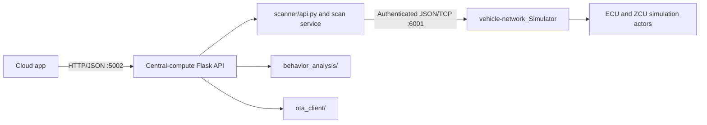

# Vehicle Central Compute

Vehicle Central Compute provides the application-layer cybersecurity services for the vehicle simulator. It is a separate container, not an in-vehicle ECU/HPC node.

## Responsibilities

- Run cybersecurity scan orchestration and diagnostic-service requests.
- Analyze simulated network telemetry and classify behavior risk.
- Score pre/post scan node features with an Isolation Forest fitted to the scan's pre-test baseline; send only aggregate scores/counts to cloud.
- Relay simulated firmware packages to the vehicle-network simulator.
- Exchange authenticated socket messages with the simulator.
- Keep a standalone `hpc_vehicle_model.py` companion model for central-side simulation and experimentation. It is not registered as a node and does not own live simulator state.
- Run a service-state-gated scan workflow: full-network diagnostics and behavior baseline, bounded simulation test, then full-network diagnostics and behavior re-analysis.
- Return aggregate scan analytics to cloud; raw node diagnostics, identifiers, signal values, and message/event records remain in central/simulator layers.

## Package Layout

```text
vehicle-central-compute/
├── scanner/
│   ├── api.py                # Flask API consumed by cloud-app
│   ├── attack_engine.py      # Whitelisted bounded simulation test scenarios
│   ├── hpc_vehicle_model.py  # Standalone central-compute companion model
│   ├── service.py            # Before/test/after scan orchestration
│   ├── vehicle_network_client.py # Authenticated client for simulator socket :6001
│   └── diagnostics_client.py  # SOVD and signal service clients
├── behavior_analysis/        # Telemetry scoring and risk classification
└── ota_client/               # Simulated firmware update relay
```

## Connection Flow



The central-compute container keeps application/API, attack, socket, and companion-model code under `scanner/`, analysis under `behavior_analysis/`, and update relay code under `ota_client/`. The active vehicle-HPC node lives in `vehicle-network_Simulator/ecus/hpc_vehicle_node.py`; `scanner/hpc_vehicle_model.py` is a standalone companion model, not a second runtime node. The `/architecture` endpoint returns the component and socket map as JSON for dashboard visualization.

## API Routes

- `GET /architecture` — central-compute modules and socket connections.
- `GET /network/snapshot` and `GET /vehicle/messages` — simulator state and traffic.
- `GET /uds/diagnostics`, `POST /uds/<ecu_id>` — simulated UDS service access.
- `POST /sovd/v1/diagnostics` — SOVD-style requests, routed to the vehicle HPC.
- `POST /signals/read` — JSON signal read through the simulated SOME/IP service.
- `POST /ota/flash` — simulator-side firmware update workflow.
- `GET /scan/types`, `POST /scan/start` — security scan orchestration.
- `GET /vehicle/service-state`, `POST /vehicle/service-state` — read/set the simulated vehicle state; scans require `in_service`.

REST requests from cloud-app require the cloud client certificate (`CN=cloud-app`) and a short-lived HS256 bearer JWT signed with `CENTRAL_SERVICE_JWT_SECRET`. Cloud checks `in_service` before dispatch; Central Compute checks again immediately before a scan. The TLS listener requires client certificates. Configure the shared JWT secret through the local security bootstrap for development; use managed secret distribution and rotated production credentials outside this simulator setup.

The dashboard configures attack duration from 1 to 60 seconds (default 10). Scan order is pre-test diagnostics and behavior analysis, the authorized simulation test, and post-test diagnostics and behavior analysis across all nodes. Isolation Forest is fit per scan to the pre-test feature vectors plus bounded baseline-relative jitter, allowing it to evaluate features that were constant during the baseline; it scores post-test vectors against that fit. Cloud analytics include the aggregate Isolation Forest anomaly score and before/after score and deviation-count deltas. The simulator starts `out_of_service`; it does not run a test until explicitly set to `in_service`. If the test action fails after pre-analysis, the workflow still attempts post-test diagnostics and reports the failure; post-analysis transport errors remain explicit. The test action creates bounded simulator-only security events and does not transmit to physical vehicle hardware.

Cloud history stores only allowlisted aggregate phase metrics, model scores/counts, and model-status labels. Per-node feature vectors are not included. This is a data-minimization measure, not a claim of legal compliance; deployment owners must separately assess their DPDP obligations and retention/access controls.

The central-compute ↔ simulator socket uses newline-framed JSON and HMAC-SHA256 with `VEHICLE_SOCKET_SECRET` (at least 32 characters). Configure the secret outside source control. HMAC does not encrypt traffic; use TLS/mTLS when crossing an untrusted network.

CAN and DoIP are simulated by the vehicle-network service's internal socket listeners; they are not physical vehicle buses. OTA and ECU flashing are simulator-only.
